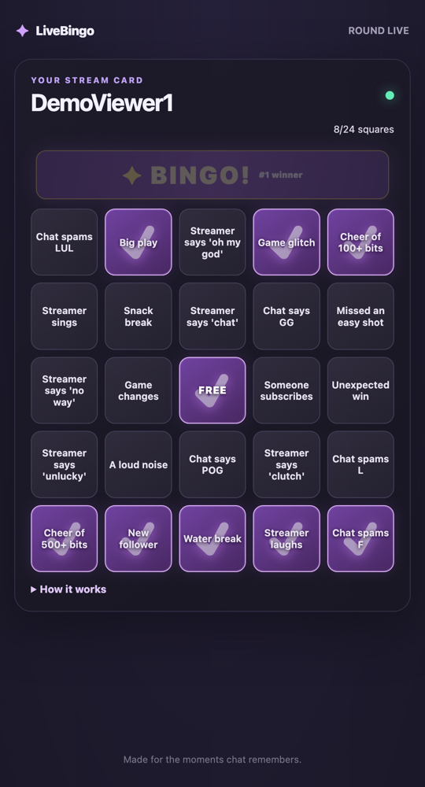

# LiveBingo

LiveBingo gives each viewer a personal 5×5 bingo card that marks itself as moments happen on a Twitch stream. The streamer controls the round from a browser dashboard, and an optional transparent overlay brings hits and winners into OBS.

Features:

- Twitch chat `!bingo` cards with live square marking and winner ranks.
- EventSub, chat-burst, voice, and manual square triggers.
- Keyboard-accessible streamer dashboard and a transparent OBS overlay.
- Local demo tools for previewing rounds without waiting for stream events.
- Fastify serves plain HTML, CSS, and JavaScript; no frontend framework.

## Screenshots / GIF



A viewer's card after `npm run demo`: squares were marked by a follow, a chat burst, a raid, cheers and manual hits, and the card won BINGO #1.

Live deployment: https://livebingo-eehe.onrender.com (free Render instance, so the first request after idle can take ~50 s).

## Twitch app settings

Create an application in the [Twitch Developer Console](https://dev.twitch.tv/console/apps) and set its category to **Website Integration**. Add both OAuth redirect URLs to the app:

- Local: `http://localhost:3000/auth/callback`
- Render: `https://livebingo-eehe.onrender.com/auth/callback`

Render adds a suffix when a service name is taken (this deployment is `livebingo-eehe`); if your URL differs, update the redirect URL and environment values to match it.

## Environment variables

Copy `.env.example` to `.env` for local use. On Render, configure the same values in the service environment.

| Variable | Purpose | Local default / notes |
| --- | --- | --- |
| `TWITCH_CLIENT_ID` | Twitch application client ID | Required |
| `TWITCH_CLIENT_SECRET` | Twitch application secret | Required; keep private |
| `TWITCH_REDIRECT_URI` | OAuth callback URL | `http://localhost:3000/auth/callback` |
| `PUBLIC_BASE_URL` | Public origin used in viewer card links | `http://localhost:3000` |
| `ADMIN_TOKEN` | Admin access for scripts and API calls | Set a long random value |
| `BROADCASTER_LOGIN` | Optional login-name restriction | Empty allows the first Twitch login to establish the channel owner |
| `OPENAI_API_KEY` | Optional AI square suggestions | Empty disables AI suggestions |
| `OPENAI_MODEL` | Model used for square suggestions | `gpt-4o-mini` |
| `DATA_DIR` | Directory for `tokens.json` and `state.json` | `./data` |
| `PORT` | HTTP port | `3000`; Render provides its own port |

## Run locally

```sh
npm ci
cp .env.example .env
# Fill in TWITCH_CLIENT_ID, TWITCH_CLIENT_SECRET, and ADMIN_TOKEN in .env.
npm run dev
```

Open [http://localhost:3000](http://localhost:3000) and select **Log in with Twitch** using the broadcaster account. The home page reports whether Twitch is connected and offers login again if the saved session expires. The dashboard is at [http://localhost:3000/dashboard](http://localhost:3000/dashboard). Viewers type `!bingo` in the channel chat to receive a card link.

The server stores its files in `DATA_DIR` (default `./data`). Keep `tokens.json` private. `/healthz` is an unauthenticated health check.

## OBS overlay

In OBS, choose **Sources → + → Browser**. Set the URL to `http://localhost:3000/overlay?panel=1&sound=1`, width to **1920**, and height to **1080**. The overlay background is transparent. `panel=1` enables the mini panel, and `sound=1` enables generated Web Audio sounds. OBS may need **Control audio via OBS** enabled. The admin-only design preview is `http://localhost:3000/overlay/test`.

## Demo mode

With the server running and `ADMIN_TOKEN` set in `.env`, run:

```sh
npm run demo
```

The script starts a fresh round, creates five demo cards, and fires sample triggers until one wins. It prints the card links and leaves the round live. The demo resets the current round, so use it for judging or a local preview rather than during a live game.

## Deploy to Render

1. Push this repository to GitHub and create a Render **Blueprint** from it. `render.yaml` defines a Node web service named `livebingo`, with `npm ci && npm run build`, `npm start`, and `/healthz` as its health check.
2. Set the Twitch client ID and secret, a long random `ADMIN_TOKEN`, and any optional broadcaster login or OpenAI key when Render prompts for unsynchronized environment values.
3. In the Twitch Developer Console, add `https://livebingo-eehe.onrender.com/auth/callback` as an OAuth redirect URL. When Render asks for the blueprint's secret values, set `TWITCH_REDIRECT_URI` to that callback and `PUBLIC_BASE_URL` to the service URL. If Render assigns a different URL, use that one everywhere instead.
4. Deploy the service and wait for `/healthz` to report healthy. Open `https://livebingo-eehe.onrender.com`, log in with Twitch, then open `/dashboard`.
5. To persist Twitch tokens and round state across deploys, attach a persistent disk (paid plans), mount it at `/var/data` and set `DATA_DIR=/var/data`.

Render free web services sleep after a period without traffic (currently around 15 minutes) and have an ephemeral filesystem. EventSub reconnects automatically while the service is running, but the free instance can sleep when idle and saved tokens and round state are lost on restart without an attached persistent disk. Use a persistent disk on a plan that supports it if saved tokens and round state must survive restarts.

## Tests

```sh
npm test
npm run build
```

## How it was built with Codex

LiveBingo's application code was written by OpenAI Codex. I planned the features, wrote one prompt per build day, tested each result on my own channel, and sent Codex the errors and changes I wanted.

- **Main thread, "Build LiveBingo Twitch foundation"** (session `01a17332-e64d-7940-b697-0794c7bd77f2`), built in four steps:
  1. Twitch OAuth, EventSub over WebSocket, and the `!bingo` chat reply.
  2. Seeded 5×5 cards, the live viewer card page, and win detection with ranks.
  3. Automatic marking from follows, subs, gift subs, raids, cheers and chat bursts; demo mode; admin protection.
  4. The streamer dashboard, AI square suggestions with structured output, and Web Speech voice triggers.
- **Second thread, "Build OBS stream overlay":** the transparent overlay with queued hit toasts, the BINGO celebration with Web Audio sounds, and the `/overlay/test` page. The same thread did the Render deploy config, token-expiry and reconnect handling, accessibility fixes and this README.
- **Security fixes I asked Codex for after reviewing its work:** only the first broadcaster (or `BROADCASTER_LOGIN`) can log in, so a visitor can't replace the bot's tokens; card IDs (which work as viewer links) are stripped from events sent to the public overlay and viewer sockets, and a test covers this.
- Each step ended with Codex running `npm test`, `npm run build` and `npm run demo` before committing. The commit history shows the steps in order.

## License

MIT. See [LICENSE](LICENSE).
